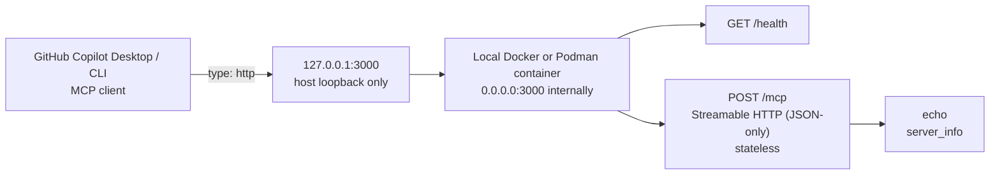

# Containerized MCP Streamable HTTP

A minimal, standalone TypeScript MCP server that runs in a local container and
connects to GitHub Copilot over stateless, JSON-only Streamable HTTP.

It exposes:

- `POST /mcp`: MCP messages over Streamable HTTP with JSON responses
- `GET /health`: process and container health
- `echo`: returns validated text unchanged
- `server_info`: returns the standalone server name, version, and transport

`GET /mcp` and every other non-`POST` method intentionally return
`405 Method Not Allowed`. The server has no stdio transport, legacy HTTP+SSE
transport, SSE response stream, or MCP sessions.

## Architecture



## Versions

The direct dependencies are pinned to versions used by the source example on
2026-08-07:

| Component | Version |
| --- | --- |
| Node.js container image | 24.13.0 |
| `@modelcontextprotocol/sdk` | 1.30.0 |
| `express` | 5.2.1 |
| `zod` | 4.4.3 |
| `typescript` | 7.0.2 |
| `vitest` | 4.1.10 |

Primary references, accessed 2026-08-07:

- [Official MCP TypeScript SDK](https://github.com/modelcontextprotocol/typescript-sdk)
- [MCP Streamable HTTP specification (2025-11-25)](https://modelcontextprotocol.io/specification/2025-11-25/basic/transports#streamable-http)
- [GitHub Copilot CLI: adding MCP servers](https://docs.github.com/en/copilot/how-tos/copilot-cli/customize-copilot/add-mcp-servers)
- [Official Node.js container image](https://hub.docker.com/_/node)

## Install and test

Requires Node.js 24 or later:

```shell
npm ci
npm run lint
npm test
npm run build
```

Run without a container:

```shell
npm start
```

The local process defaults to `127.0.0.1:3000`. The container sets
`HOST=0.0.0.0` internally so published ports work.

## Build and run with Docker

```shell
docker build -t containerized-mcp-streamable-http .
docker run --rm -d --name containerized-mcp-streamable-http \
  -p 127.0.0.1:3000:3000 containerized-mcp-streamable-http
curl http://127.0.0.1:3000/health
docker stop containerized-mcp-streamable-http
```

## Build and run with Podman

```shell
podman build -t containerized-mcp-streamable-http .
podman run --rm -d --name containerized-mcp-streamable-http \
  -p 127.0.0.1:3000:3000 containerized-mcp-streamable-http
curl http://127.0.0.1:3000/health
podman stop containerized-mcp-streamable-http
```

Publishing to `127.0.0.1` is deliberate. This unauthenticated demonstration is
not exposed on other host interfaces.

## Configure GitHub Copilot Desktop or CLI

The committed [`.github/mcp.json`](.github/mcp.json) is the supported shared
repository configuration. Open this trusted repository in a local Copilot
Desktop/App project or start Copilot CLI from its root after the container is
running.

For portable user configuration, add the same server to
`~/.copilot/mcp-config.json`. If `COPILOT_HOME` is set, use
`$COPILOT_HOME/mcp-config.json` instead:

```json
{
  "mcpServers": {
    "containerized-mcp-streamable-http": {
      "type": "http",
      "url": "http://127.0.0.1:3000/mcp",
      "tools": ["echo", "server_info"]
    }
  }
}
```

The type must be `http`, which selects Streamable HTTP. Do not configure
`sse`, `stdio`, or `local`.

The supported CLI command is:

```shell
copilot mcp add --transport http --tools echo,server_info \
  containerized-mcp-streamable-http http://127.0.0.1:3000/mcp
```

Inside Copilot CLI, verify discovery:

```text
/mcp show containerized-mcp-streamable-http
```

Then ask Copilot:

```text
Use the containerized-mcp-streamable-http server_info tool and show its exact result.
Use the containerized-mcp-streamable-http echo tool with exactly "hello MCP".
```

Expected results:

```json
{"name":"containerized-mcp-streamable-http","version":"1.0.0","transport":"Streamable HTTP (JSON-only)"}
```

```text
hello MCP
```

Start a new desktop project session after adding or changing MCP configuration;
an already-running session may not reload its tool catalog. If MCP content is
blocked by an administrator, the organization or enterprise MCP policy and
allowlist must permit this server.

## Evidence

The source implementation from which this standalone repository was extracted
was verified on 2026-08-07 with MCP SDK 1.30.0, six passing tests, Docker, and
a fresh GitHub Copilot Desktop-managed session. That Desktop session listed
and invoked both tools; `echo("desktop-app-client-ok")` returned
`desktop-app-client-ok`.

This standalone repository changes the package/server name and makes the
transport label explicit. On 2026-08-07, the extraction passed `npm ci`,
type-check lint, all six tests, and the TypeScript build. Its Docker image was
built and run on `127.0.0.1:3000`; HTTP checks and the official MCP SDK client
confirmed initialization, tool listing, both tool calls, JSON responses, no
session ID, and 405 responses for unsupported methods. Podman was not installed
in the validation environment. No fresh Desktop test was performed against the
standalone repository, so the source Desktop result remains prior evidence.

See [DEMO.md](DEMO.md) for a presenter-focused walkthrough.

## Production boundary

This is a local demonstration, not a production deployment. A production or
shared MCP server requires HTTPS, authentication and authorization (typically
OAuth), deployment-specific Origin validation, managed secrets, network access
restrictions, and a narrow tool allowlist. Enterprise GitHub Copilot MCP policy
and registry/allowlist controls must also permit the server. Never put
credentials in MCP configuration files.

## Current upstream advisories

On 2026-08-07, a clean `npm ci` followed by `npm audit` reports five affected
package entries: three high and two moderate. They trace to two transitive
advisories in the MCP SDK 1.30.0 dependency graph:

- High:
  [`fast-uri` host confusion, GHSA-7p8r-x3mc-p8w7](https://github.com/advisories/GHSA-7p8r-x3mc-p8w7)
  affects installed `fast-uri` 3.1.4 through `ajv`.
- Moderate:
  [Hono CORS middleware ReDoS, GHSA-8j4g-w8fx-2239](https://github.com/advisories/GHSA-8j4g-w8fx-2239)
  affects installed Hono 4.12.32.

No compatible patched release is currently available: 3.1.4 is the latest
`fast-uri` 3.x release accepted by the dependency graph, and 4.12.32 is the
latest Hono release while its advisory names 4.12.34 as patched. The only
automatic action offered by npm is a breaking downgrade of
`@modelcontextprotocol/sdk` from 1.30.0 to 1.25.3. This example retains the
required SDK version. Re-run `npm audit` and update patched transitive releases
before production use.

## License

No license is included. The source repository does not contain an applicable
license file for this extraction, so no license was invented. Copyright law
applies by default.
